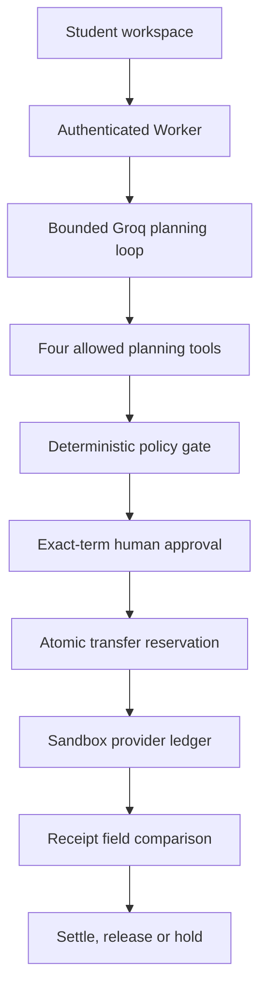

# TuitionGuard — Technical Documentation
International Track · Topic C: Cross-border & Student Finance Assistant

## 1. Product and contribution
TuitionGuard stages the lowest-cost verified, on-time tuition payment while preserving an explicit living-expense reserve. The contribution is a complete bounded financial workflow with human approval and independent receipt comparison, rather than a conversational recommendation alone. No global novelty, adoption, or real-world fraud accuracy is claimed.

Supported corridor: VND source balance, CNY tuition; one fictional verified university, three illustrative providers. All accounts and transfers are simulated. All amounts, fees and arrival estimates shown in the UI are sandbox values.

## 2. Architecture
- React workspace: invoice input, readable PDF extraction, route review, exact-term approval, receipt viewer, execution evidence and evaluation.
- Cloudflare Worker API: authenticated owner checks, cross-origin protection, orchestration, immutable plan persistence and payment policy enforcement.
- D1: accounts, plans, transactions and an independently stored provider_ledger. Unique invoice and plan indexes prevent duplicate transfer creation within a session.
- Bounded Groq agent: model requests local functions through the chat-completions tool-call protocol. The application validates and executes the calls. Without a key, a deterministic workflow invokes the same tools and is labelled accordingly.
- Sandbox provider adapter: issues a receipt into its own ledger at submission. Status lookup reads that ledger; reconciliation never manufactures a success receipt from the transaction record.

The provider has an independent ledger and contract, but shares the Worker and D1 infrastructure. It is NOT a separate bank, signed external oracle or externally hosted provider. This is an explicit prototype boundary.

## 3. Agent implementation
Allowlist: read_invoice, verify_recipient, get_transfer_quotes, check_payment_policy. Each event records start time, duration, arguments, outputs and result. Invoice ID, student reference and recipient extracted by the model must occur literally in the supplied text; this is a limited source check, not semantic validation. Missing fields produce a clarification request and no executable plan. Recipient verification and quote lookup must complete before policy evaluation. The loop is bounded to six model responses and at most four tool calls per response. Unknown tools and out-of-order calls are blocked.

The agent has no approve, submit, reset, reserve-editing or receipt-correction tool. Execution belongs to authenticated API handlers and human UI actions. Narrative assistant answers cannot execute actions. AI tool-protocol tests use a mocked model and are not evidence of live model reliability.

## 4. Monetary calculations and selection
Amounts must be positive, <= 1,000,000 CNY, with <= two decimals. Integer rational arithmetic converts CNY cents into whole VND debits, rounded half-up; fixed and basis-point fees are included.

Debit = round(amountCNY × rateVNDperCNY × (1 + bps/10000)) + fixedFeeVND.

A route is eligible only if:
1. Institution and account exactly match trusted directory version 1.
2. Currency is CNY and debit <= 500,000,000 VND.
3. Estimated arrival is no later than the explicit timezone-aware deadline.
4. balance − existing reservations − new debit >= protected reserve.

Choose the lowest debit among eligible routes, then lowest arrival time and stable provider ID. When blocked, explain the exact reserve shortfall or required recipient/deadline correction; never reduce reserve automatically.

Illustrative example: 30,000 CNY, 48-hour deadline, 125,000,000 VND balance and 18,000,000 VND reserve. A costs 105,625,000 VND and arrives in 24 hours. B costs 104,858,800 but takes 72 hours. C costs 105,650,000 and takes 24 hours. A is selected and leaves 19,375,000 VND available.

## 5. Approval and atomic execution
A SHA-256 fingerprint binds invoice, chosen quote, protected reserve, expiry and sandbox generation. It is an integrity fingerprint, not a signature or a tamper-proof audit chain. Plans expire after five minutes. Submit rechecks authentication, approval boolean, fingerprint, expiry, session, reserve and policy.

A D1 transactional batch conditionally inserts the transfer, creates a separate provider-ledger entry, and reserves funds. Unique(owner, generation, invoice_key) and unique(plan_id) enforce duplicate protection. Failure rolls back the batch. Repeated submissions retrieve the existing transaction. Rejected invoices remain protected against automatic re-payment; a new demo session is required to replay that invoice.

## 6. Reconciliation state machine
Provider scenarios: normal, timeout after acceptance, pending, rejected, amount mismatch and recipient mismatch. A pending provider settles on a later poll. Timeout does not permit resubmission.

Compare provider reference, invoice ID, student reference, recipient, currency, delivered amount, debit and provider ID against approved terms.
- Matching SETTLED receipt: debit posted balance and release reservation once.
- Matching REJECTED receipt: release reservation without debit.
- PENDING: keep funds reserved and query again.
- Any mismatch: REVIEW_REQUIRED; keep funds reserved.

Sandbox-only receipt correction requires an explicit user action after a discrepancy is recorded. It changes the provider record, records a correction reason and time, and moves no funds. A separate reconciliation is required. Production corrections would require external provider authority and a separate operator role.

## 7. APIs
GET/POST /api/workspace: owner account, history, explicit sandbox reset.
POST /api/analyze: bounded planning workflow or clarification.
POST /api/pay: human-approved transfer submission.
GET /api/provider: owner-scoped provider status lookup.
POST /api/provider: explicitly confirmed sandbox discrepancy correction.
POST /api/reconcile: independent receipt comparison and atomic terminal state.
POST /api/assistant: grounded explanation, no execution tools.

## 8. Evaluation and limitations
See evaluation-report.md and the machine-readable reports. Synthetic benchmark, handler-adapter tests, built Worker/local D1 tests and mocked agent tests are reported separately. No live Groq reliability, external bank integration, browser usability study, live rates or real-world financial compliance result is claimed.

## 9. Reproduction
See README.md and tests/run-all.mjs. Node 24 is recommended for the built-in SQLite test adapter; the application runtime supports the starter's supported Node version. The source archive includes lockfile, migrations, tests, synthetic dataset and submission documents. Deployment outside Sites requires replacing the trusted identity boundary with authenticated middleware; never accept identity headers directly from untrusted public clients.

## Review update: live evaluation and stronger validation
POST /api/live-check accepts one of three authored planning checks and requires authentication plus a user-supplied Groq key. It returns actual provider-reported token usage, requested/resolved model IDs, duration, observed/expected outcomes and tool events. It does not write plans, accounts or transactions. Missing token usage is reported as unknown; no pricing or monetary cost is invented.
The app also rejects unknown receipt states, malformed amount fields and impossible calendar dates, binds the approved available balance at the atomic insert, and reports reconciliation from persisted state. See competition-readiness-review.md and review-regression-report.json.

## Public AI Connection panel (updated 16 October 2026)
`app/ai-connection.tsx` now runs the same bounded orchestrator as `/lab` (`lib/agent.ts`) through `lib/ai-live-check.ts` on four synthetic cases: normal invoice (route A), reserve breach (blocked), unverified recipient (blocked) and an invoice containing an injected `submit_payment` instruction (safe: no forbidden tool, verified recipient only).

- **Deterministic (no AI):** no model call; verifies tool order and policy only.
- **Live AI agent:** choose **Google Gemini** (default model `gemini-3.8-flash`, via Google's OpenAI-compatible endpoint; Gemini thought signatures are passed back unchanged) or **Groq** (default model `openai/gpt-oss-120b` (`llama-3.3-70b-versatile` was retired by Groq on 16 August 2026); requires the reviewer's own key for that provider; sends the four real tool definitions with `tool_choice=auto`.
- PASS is computed from the observed outcome. A prose-only reply or HTTP error is FAIL. Latency is measured, model calls are counted and tokens are provider-reported or `null`. The former sandbox/mock key mode was removed.
- Tests: `tests/ai-live-check.mjs` (34 checks against fake Groq and Gemini endpoints, included in `pnpm test`).

The full Word version of this documentation is `TuitionGuard_Technical_Documentation.docx` in this folder.
